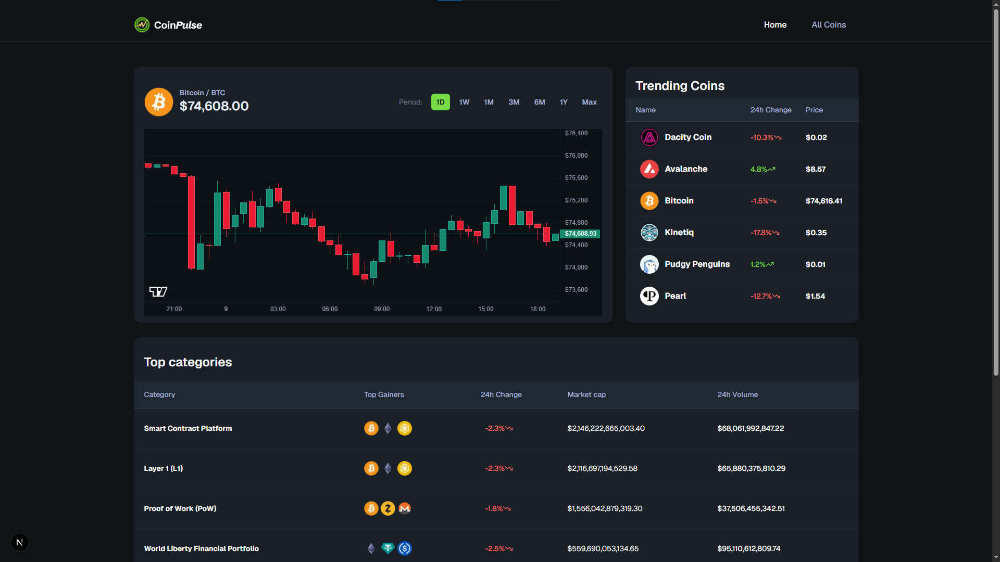

<div align="center">


# CoinPulse

### Your real-time window into the crypto market.

Explore trending coins, compare market data, and inspect price movements with interactive charts.


</div>

---

## 📸 Preview

<!-- Replace this path with the location of your application screenshot. -->
<div align="center">
  
  <sub>CoinPulse dashboard</sub>
</div>

## ✨ Features

- **Market overview** — See Bitcoin’s price and chart alongside trending coins.
- **Coin discovery** — Browse market listings with price, rank, market cap, and 24-hour change.
- **Coin details** — View a coin’s price chart, market information, and related links.
- **Interactive charts** — Explore historical price data across selectable time periods.
- **Market categories** — Review category data and top-performing coins.
- **Currency converter** — Convert between supported currencies using current market prices.
- **Loading skeletons** — Keep the interface responsive while data is loading.

## 🧰 Built with

- [Next.js](https://nextjs.org/) and [React](https://react.dev/)
- [TypeScript](https://www.typescriptlang.org/)
- [Tailwind CSS](https://tailwindcss.com/)
- [Lightweight Charts](https://www.tradingview.com/lightweight-charts/)
- [CoinGecko API](https://www.coingecko.com/en/api)
- [Shadcn](https://ui.shadcn.com/)

## 🌐 Live URL

- [CoinPulse](https://coinpulse-neon.vercel.app/)

## 🚀 Getting started

### Prerequisites

- Node.js
- pnpm
- A CoinGecko API key and API base URL

### 1. Install dependencies

```bash
pnpm install
```

### 2. Environment Variables

- Check the .env.example file to get your API_KEY and other needed variables from [CoinGecko](https://docs.coingecko.com/)
